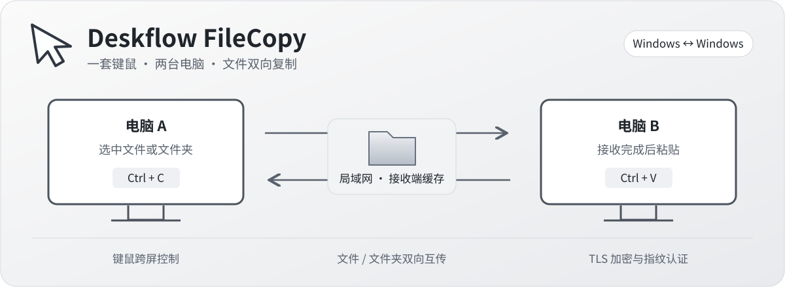
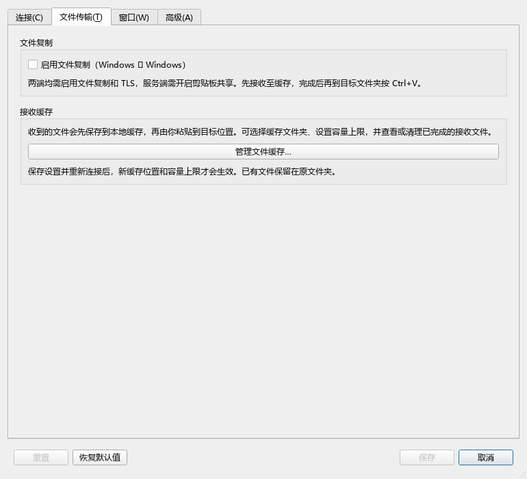
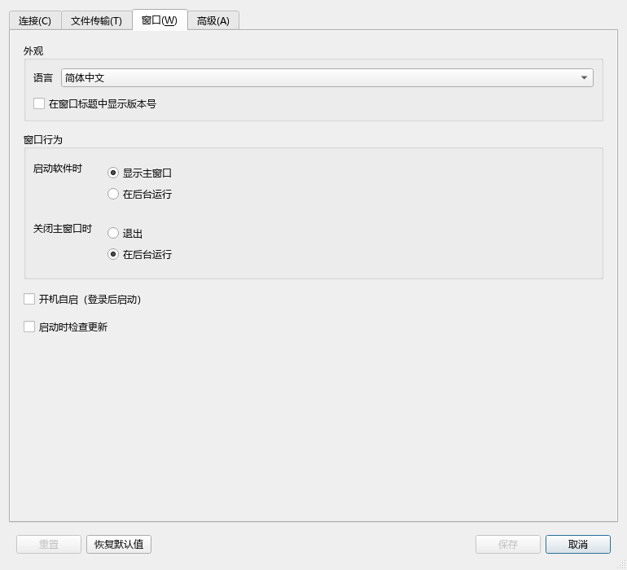

<p align="center">
  
</p>

<h1 align="center">Deskflow FileCopy</h1>

<p align="center">一套键鼠控制两台电脑，文件和文件夹也能跨电脑复制粘贴。</p>

<p align="center">
  <a href="https://github.com/EugeneEvan/deskflow-filecopy/releases/download/filecopy-v0.4.0/deskflow-filecopy-0.4.0-windows-x64-setup.exe"><strong>下载 Windows 安装包</strong></a>
  · <a href="https://github.com/EugeneEvan/deskflow-filecopy/releases/tag/filecopy-v0.4.0">版本说明与便携包</a>
  · <a href="#快速上手">快速上手</a>
  · <a href="#常见问题">常见问题</a>
  · <a href="https://github.com/EugeneEvan/deskflow-filecopy/issues">反馈问题</a>
</p>

> 基于 [Deskflow](https://github.com/deskflow/deskflow) 二次开发的独立、非官方开源项目，保留上游键鼠共享能力，增加 Windows 文件互传与可选的完整控制组件。**文件复制目前仅支持 Windows ↔ Windows，提供 Windows x64 安装包。** 本项目不由 Deskflow 上游团队发布或背书。

## 能做什么

| 功能 | 使用体验 |
|---|---|
| 键鼠共享 | 鼠标移过配置的屏幕边缘，即可控制另一台电脑；键盘输入跟随当前控制位置 |
| 双向文件复制 | 在一端选中文件或文件夹按 Ctrl+C，接收完成后在另一端按 Ctrl+V |
| 文件夹与多文件 | 支持多选、递归目录、中文文件名、空文件和空目录 |
| 共享剪贴板 | 共享文字与支持的图片格式；大图片受独立的剪贴板大小限制 |
| 传输进度 | 显示已传大小、文件数量、速度、预计剩余时间；支持取消 |
| 缓存管理 | 可选缓存磁盘、设置容量、查看占用并清理已完成的接收批次 |
| 管理员窗口 | 0.4.0 可选启用完整控制组件，支持管理员窗口和 UAC 安全桌面 |
| 日常使用 | 简体中文界面、当前连接 IP、托盘状态、登录后自动启动 |

适合同时使用台式机和笔记本、在两台 Windows 电脑之间共享键鼠并传递资料的场景。电脑需要能够直接联网；本项目不提供公网中继、远程画面或云盘服务。

## 下载与版本选择

| 版本 | 定位 | 适合谁 |
|---|---|---|
| **[0.4.0](https://github.com/EugeneEvan/deskflow-filecopy/releases/tag/filecopy-v0.4.0)** | **正式推荐版** | 新安装和日常使用；包含完整控制组件及双向文件剪贴板修复 |
| [0.3.5](https://github.com/EugeneEvan/deskflow-filecopy/releases/tag/filecopy-v0.3.5) | 回退版本（保留原预发布标记） | 需要回退到未引入完整控制组件的桌面模式版本 |

**一般使用者下载安装版；无需安装时选择便携版。两台电脑应使用同一版本。**

| 下载内容 | 用途 |
|---|---|
| [Windows x64 安装版](https://github.com/EugeneEvan/deskflow-filecopy/releases/download/filecopy-v0.4.0/deskflow-filecopy-0.4.0-windows-x64-setup.exe) | 可选择安装目录，提供卸载入口 |
| [Windows x64 便携版](https://github.com/EugeneEvan/deskflow-filecopy/releases/download/filecopy-v0.4.0/deskflow-filecopy-0.4.0-windows-x64-portable.zip) | 完整解压到可写的独立目录，运行其中的 <code>deskflow.exe</code> |
| [SHA-256 校验清单](https://github.com/EugeneEvan/deskflow-filecopy/releases/download/filecopy-v0.4.0/deskflow-filecopy-0.4.0-SHA256SUMS.txt) | 核对安装包或 ZIP 是否完整 |
| [构建信息](https://github.com/EugeneEvan/deskflow-filecopy/releases/download/filecopy-v0.4.0/deskflow-filecopy-0.4.0-BUILD-INFO.txt) | 查看对应源码提交、工具链及验证范围 |

安装到独立目录，例如 <code>D:\Apps\Deskflow FileCopy</code>，避免覆盖原版 Deskflow。便携包**不能只复制 EXE**，否则可能缺少 Qt DLL 或插件。当前社区构建未签名，Windows 可能显示“未知发布者”；请核对本仓库的下载来源和校验值。

<details>
<summary>如何校验安装包</summary>

在下载目录打开 PowerShell：

```powershell
Get-FileHash -Algorithm SHA256 -LiteralPath ".\deskflow-filecopy-0.4.0-windows-x64-setup.exe"
```

将输出的 Hash 与同一版本 SHA256SUMS.txt 中的安装包条目比较；ZIP 用同样方式校验。不要混用不同版本的清单。

</details>

## 快速上手

### 1. 安装两端并分配角色

- **主控／服务端**：连接你实际使用的键盘、鼠标或触摸板的电脑。
- **副机／客户端**：希望通过主控键鼠控制的另一台电脑。

先退出旧版本，确保同一电脑没有重复运行的 Deskflow 核心或旧服务。首次运行先完成配置，再启动连接。

### 2. 配置屏幕位置和网络

在主控选择服务端模式，打开服务端配置，添加副机的屏幕名称。名称应与副机显示的电脑名称一致；将副机拖到与你桌面摆放一致的位置，例如主控左侧。

在副机选择客户端模式，填写主控在当前网络中可访问的 IP。两端启动后，按 Windows 提示允许可信局域网中的连接；默认连接端口为 TCP **24800**。

两端启用 **TLS 加密**。首次配对时核对对端显示的证书指纹，再确认信任。主窗口会显示连接数量及本次连接实际使用的 IP；先确认鼠标能够跨屏，再测试文件复制。

### 3. 打开文件复制

1. 两端进入 **设置 → 文件传输**，勾选 **启用文件复制（Windows ↔ Windows）**。
2. 确保主控的服务端配置已启用**剪贴板共享**，两端均启用 TLS。
3. 按需设置接收缓存位置和容量，保存后重新连接。

文件复制首次使用默认关闭。只在一端开启、使用原版 Deskflow 作为另一端，或未满足加密与剪贴板条件时，不能使用本扩展的文件互传。

<p align="center">
  <a href="docs/images/settings-file-transfer.png"></a>
</p>

*实际 Qt 设置界面，截取自 0.3.5 的离屏界面验证；0.4.0 保留图中的文件传输入口。图片展示设置位置，勾选状态并非推荐配置。*

### 4. 复制、等待、粘贴

1. 在电脑 A 的资源管理器中选中文件或文件夹，按 **Ctrl+C**。
2. 将指针移到电脑 B，等待接收端提示**文件就绪，可以粘贴**。
3. 在电脑 B 打开目标文件夹，按 **Ctrl+V**。
4. 反向传输时交换 A、B，操作相同。

文件会先完整传到接收端缓存，校验完成后才放入文件剪贴板。因此大文件需要先等待传输完成；粘贴到最终目录时还会发生一次本机文件复制。最终目录出现同名文件时，由 Windows 的粘贴界面决定替换、跳过或重命名。

传输中可查看进度和取消任务。速度与剩余时间是动态估算，准备、校验、等待确认或长时间没有字节推进时可能暂不显示。只有成功完成后才显示 100%。

## 缓存与磁盘空间

**安装目录与接收缓存目录是两项独立设置。** 安装到 D 盘，不会自动把缓存移到 D 盘。

| 设置 | 默认值与建议 |
|---|---|
| 缓存位置 | <code>%LOCALAPPDATA%\Deskflow\file-transfer</code>，通常位于 C 盘 |
| 修改入口 | 主界面“管理缓存”，或“设置 → 文件传输 → 管理文件缓存” |
| 推荐位置 | 其他本地磁盘上的专用目录，例如 <code>D:\DeskflowCache</code> |
| 容量配额 | 默认 20 GiB，可设置为 1–1,024 GiB |
| 生效方式 | 保存后重新连接，新的接收任务使用新位置和配额 |

缓存目录不能使用网络路径、磁盘根目录或符号链接／目录联接。修改位置**不会迁移或删除旧缓存**。统计占用包括目录中的其他文件，请使用专用目录。

接收成功的文件**不会自动过期清理**。手动清理只处理带有本版本管理标记的缓存批次，并保留当前剪贴板引用的批次；正在接收时需稍后再试。旧版缓存和其他文件不会被清理工具删除。清理前应确认文件已粘贴到最终位置。

## 管理员窗口与 UAC

普通桌面模式适合日常使用。需要操作副机的注册表编辑器、管理员 PowerShell 或 UAC 确认窗口时，在**需要被控制的电脑**启用完整控制组件：

1. 先以普通模式成功连接两端，核对并信任 TLS 指纹。
2. 保存连接、文件传输和缓存设置。
3. 打开 **设置 → 高级 → Windows 完整控制**，选择**启用 / 更新组件**，完成 Windows 管理员授权。
4. 返回主界面，确认重新连接成功，再测试管理员窗口操作。

系统服务负责键鼠控制；独立文件代理使用当前登录用户的权限处理文件。组件不会关闭 UAC，也不会把用户文件操作提升为 SYSTEM 权限。文件代理不可用时，文件能力会停止；安全桌面期间文件发布会等待返回用户桌面并重新核对剪贴板状态。

组件安装在应用所在磁盘的 <code>Deskflow FileCopy Control</code> 独立目录，并使用管理员确认的配置快照。**修改连接、缓存或信任设置后，需要保存并应用到组件；升级普通应用后，也要更新组件。**

此模式不导入外部服务端配置文件、进入／离开屏幕的自定义命令。只信任你认可的电脑；主控和副机可以分别决定是否启用。

## 开机自启

两端均可打开 **设置 → 窗口 → 开机自启（登录后启动）**，点击“保存”生效。安装版与便携版均支持；默认关闭。也可以在安装时选择登录后启动。

应用正常退出时会记住核心的启动状态，登录后按已保存状态恢复；首次仍需完成连接配置。普通应用的登录自启与完整控制系统服务的启动是不同机制。

<details>
<summary>查看开机自启设置图片</summary>

<p align="center">
  <a href="docs/images/settings-startup.png"></a>
</p>

实际 Qt 设置界面，截取自 0.3.5 的离屏界面验证；0.4.0 保留图中的登录自启设置。

</details>

## 升级、回退与卸载

| 操作 | 步骤 |
|---|---|
| 普通模式升级 | 退出两端旧程序，使用同一新版安装包升级，重新启动连接；建议先备份安装目录下的 <code>settings</code> |
| 已启用完整控制时升级 | 先在主窗口点击“停止”并完成管理员确认，退出应用并升级，再用新应用的高级设置“启用 / 更新组件”，核对连接 |
| 回退到 0.3.5 | 先停用完整控制组件并备份设置，再退出 0.4.0；两端都换用 0.3.5，按桌面模式重新配置和连接 |
| 卸载 | 先停用完整控制，再退出应用并使用卸载程序；确认接收文件已粘贴到最终目录后，自行处理保留的目录与缓存 |

安装器会保留已有配置和当前用户的开机自启选择。回退并不等于保证旧版本能读取所有新配置，保留备份有助于恢复。停用完整控制会移除本组件服务；相关目录及用户文件保留。程序不会替你删除已经接收或粘贴到其他目录的资料。

## 当前支持范围

| 项目 | 范围 |
|---|---|
| 文件互传平台 | Windows ↔ Windows；发布包为 Windows x64 |
| 单批总大小 | 最多 10 GiB |
| 单批条目 | 最多 10,000 个文件和目录，包含递归子项 |
| 文件类型 | 普通文件、目录、多选、中文路径、空文件和空目录 |
| 同名顶层条目 | 同一批选择中出现同名顶层文件／目录时拒绝，不自动合并 |
| 双向同时复制 | 冲突任务会取消，需要重新复制 |
| 尚不支持 | 跨机剪切、拖放、断点续传、符号链接／目录联接、跨平台文件互传、多个客户端之间经服务端中转 |

上游 Deskflow 的跨平台能力不代表本扩展支持跨平台文件互传。不要把上游下载包作为文件互传的另一端。

## 常见问题

<details>
<summary><strong>连接超时，或者鼠标不能进入副机</strong></summary>

先确认副机填写的是主控当前可访问的 IP、主控核心正在运行、屏幕名称与布局一致，且防火墙允许相应 TCP 端口。检查 TLS 指纹是否已核对信任；不要同时运行多个旧核心或旧服务。主窗口的日志可以展开查看具体原因。

完整控制模式下修改了连接设置，还需要保存并应用到组件。端口可连通只说明网络端口可达，不代表 TLS 配对和 Deskflow 会话已建立。

</details>

<details>
<summary><strong>鼠标可以跨屏，但文件无法粘贴</strong></summary>

核对两端版本一致、文件复制均已开启、TLS 已启用、服务端开启剪贴板共享。先等待接收端显示文件就绪，再到资源管理器的目标目录粘贴。也要检查缓存配额、可用磁盘空间和错误提示。

请从资源管理器复制实际文件；复制网页链接、聊天附件引用或云文件占位信息，不等于选中了可读取的本地文件。完整控制模式还需要文件代理正常运行。

</details>

<details>
<summary><strong>图片偶尔不共享，而文字可以</strong></summary>

图片与文件复制走不同的剪贴板数据处理。普通剪贴板默认上限为 64 MiB；旧配置可能仍保留 3 MiB，可在主控的服务端配置中检查并调高剪贴板大小，保存后重新连接。

大小按**未压缩位图**计算，不能拿 PNG/JPEG 文件大小直接比较。Windows DIB/DIBV5 格式已覆盖相关测试，但不保证所有截图、浏览器和聊天软件都提供相同格式。

</details>

<details>
<summary><strong>明明在局域网，为什么大文件仍需要等待</strong></summary>

传输包含源盘读取、网络发送、接收盘写入、内容校验和粘贴到最终目录。实际速度受网卡协商速率、磁盘、文件数量、加密和杀毒扫描影响；“直连”不意味着所有阶段都没有瓶颈。

文件复制采用先缓存后粘贴的方式。大量小文件与单个大文件的表现也会不同，不应把某次测速当作所有设备的速度保证。

</details>

<details>
<summary><strong>为什么显示 Qt6Gui.dll 丢失</strong></summary>

使用本项目完整安装包，或完整解压便携 ZIP。不要从开发构建目录中单独复制 EXE，也不要混用不同版本的 DLL。安装包和便携包会携带对应运行库与 Qt 插件。

</details>

<details>
<summary><strong>应用里显示的版本号为什么不是 0.4.0</strong></summary>

0.4.0 是 FileCopy 的发行版本。底层 Deskflow 核心、协议和部分界面仍沿用上游版本体系；0.4.0 对应已发布核心为 <code>1.26.0.459+a8aefecb</code>，具体见同一 Release 的构建信息。

</details>

## 验证与发布节奏

**0.4.0 的历史验收（2026-10-14）**包括：

- Windows Release 构建与 46 个选定 CTest 套件；真实进程隔离测试另行执行，4 项通过、无跳过。
- 两台物理 Windows 电脑的双向文件验收：每个方向 5 个文件、4 个目录，接收缓存和脚本复制后的目标文件 SHA-256 一致。
- 用户实机确认 UAC 点击、管理员 PowerShell 输入与关闭、托盘提示、触摸板滚动和跨屏正常。
- 普通用户权限边界 7 项检查及服务停止、应用配置、启动重连验证。
- 副机到主控的合成文字和 48×32 位图校验。

这些是已有验收记录，**本次 README 整理没有重新执行软件测试**。其中不包含所有 Windows 版本、所有截图软件、全部触摸板驱动、多用户快速切换或长期压力场景；文件目标复制脚本验收也不等于本轮人工 Explorer Ctrl+V 验收。详见 [0.4.0 完整发布说明](https://github.com/EugeneEvan/deskflow-filecopy/releases/tag/filecopy-v0.4.0)。

Releases 保留一个推荐版本，最多再保留一个回退版本。小修复会合并验证后集中发布，文档调整不新增安装包版本；旧发布以草稿归档，源码标签保留。当前推荐 0.4.0，回退版本为 0.3.5。

<details>
<summary>开发者：Windows x64 源码构建与打包</summary>


## 从源码构建（Windows x64）

需要支持 C++20 的 MSVC、Windows SDK、Git、CMake 3.24 或更高版本、Ninja 和 vcpkg。项目要求 Qt 6.7 或更高版本及 OpenSSL 3.0 或更高版本，具体由 [CMake 配置](CMakeLists.txt)和 [vcpkg 基线及依赖模板](cmake/vcpkg.json.in)定义。

已验证工具组合：MSVC 14.44、Windows SDK 10.0.26100、CMake 4.4.3、Ninja 1.13.2、Qt 6.11.1、OpenSSL 3.6.4。

### 1. 准备工具和源码

准备上述工具，打开已配置 **x64 MSVC 与 Windows SDK 环境**的 Developer PowerShell。将本仓库克隆到本地后进入仓库根目录。以下是可按实际磁盘修改的示例路径：

```powershell
git clone https://github.com/EugeneEvan/deskflow-filecopy.git
Set-Location deskflow-filecopy

$env:TEMP = 'D:\DevTools\tmp'
$env:TMP = $env:TEMP
$env:VCPKG_ROOT = 'D:\DevTools\vcpkg'
$env:VCPKG_DOWNLOADS = 'D:\DevTools\vcpkg-downloads'
$env:VCPKG_DEFAULT_BINARY_CACHE = 'D:\DevTools\vcpkg-cache'
New-Item -ItemType Directory -Force $env:TEMP, $env:VCPKG_DOWNLOADS, $env:VCPKG_DEFAULT_BINARY_CACHE | Out-Null

git clone https://github.com/microsoft/vcpkg.git $env:VCPKG_ROOT
& "$env:VCPKG_ROOT\bootstrap-vcpkg.bat" -disableMetrics
```

已有 vcpkg 时直接设置 `VCPKG_ROOT`，不必重复克隆。Visual Studio 安装器可能仍使用系统盘存放共享组件；上面的缓存路径设置不代表所有工具零占用 C 盘。

### 2. 配置与编译

在本仓库根目录执行：

```powershell
cmake -S . -B D:\DevTools\deskflow-filecopy-build -G Ninja `
  -DCMAKE_BUILD_TYPE=Release `
  "-DCMAKE_TOOLCHAIN_FILE=$env:VCPKG_ROOT/scripts/buildsystems/vcpkg.cmake" `
  -DVCPKG_TARGET_TRIPLET=x64-windows `
  -DVCPKG_QT=ON `
  -DBUILD_INSTALLER=OFF `
  -DBUILD_TESTS=ON `
  -DSKIP_BUILD_TESTS=ON

cmake --build D:\DevTools\deskflow-filecopy-build --parallel 4
```

此配置使用 [vcpkg manifest 模式](https://learn.microsoft.com/en-us/vcpkg/users/buildsystems/cmake-integration)恢复依赖，首次编译 Qt 可能耗时较长并占用较多磁盘。`VCPKG_QT=ON` 会由 CMake 生成仓库的 `vcpkg.json`，不要手动编辑生成结果。

`BUILD_INSTALLER=OFF` 生成程序与测试，不生成可分发安装器。`SKIP_BUILD_TESTS=ON` 仅关闭构建后的自动测试，下一步仍需单独执行验证。可执行文件位于构建目录的 `bin`，开发构建目录不一定带齐可分发运行库。

### 3. 运行测试

```powershell
ctest --test-dir D:\DevTools\deskflow-filecopy-build\src\unittests `
  --output-on-failure --interactive-debug-mode 0 --timeout 180 --no-tests=error -E "^MSWindowsClipboardTests$"
```

Windows CTest 配置会为测试注入 Qt DLL 和平台插件路径，避免缺少 `Qt6Gui.dll` 时反复弹窗。上述命令排除会修改真实剪贴板的旧 MSWindowsClipboardTests；运行其他涉及桌面会话的测试前，也请先完成正在进行的复制粘贴操作。符号链接测试需要相应系统权限，否则明确报告跳过。

文件会话测试包含真实的 60 秒 ACK 超时回归，因此整套测试通常至少需要一分钟，不能把 CTest 单套超时设为 60 秒。

格式检查使用 `clang-format 20.1.0`，与仓库 CI 约定保持一致。上游一般构建说明可参考 [Deskflow Building](https://github.com/deskflow/deskflow/wiki/Building)，本扩展的配置以上述内容和当前源码为准。

### 4. 制作安装程序和便携包

使用 [Windows 打包脚本](deploy/windows/package-filecopy.ps1)从已验证的 Release 构建制作 ZIP、安装程序和 SHA-256 清单。需要 PowerShell 5.1 或更高版本、Inno Setup 6.7 或更高版本、MSVC 的 x64 `dumpbin.exe`，以及与构建匹配的 vcpkg 运行库、Qt 插件和 MSVC 可再分发 CRT。脚本不会安装这些依赖，也不会编译源码或签名程序。

以下示例需将工具版本目录替换为本机实际路径；`DependenciesDirectory` 应指向当前构建实际使用的 `x64-windows` 依赖目录，manifest 模式通常位于构建目录的 `vcpkg_installed` 下：

```powershell
.\deploy\windows\package-filecopy.ps1 `
  -BuildDirectory D:\DevTools\deskflow-filecopy-build `
  -DependenciesDirectory D:\DevTools\deskflow-filecopy-build\vcpkg_installed\x64-windows `
  -CrtDirectory D:\DevTools\MSVC\VC\Redist\MSVC\14.44.35112\x64\Microsoft.VC143.CRT `
  -Dumpbin D:\DevTools\MSVC\VC\Tools\MSVC\14.44.35207\bin\Hostx64\x64\dumpbin.exe `
  -Iscc D:\DevTools\InnoSetup\ISCC.exe `
  -OutputDirectory D:\Releases\deskflow-filecopy-0.4.0 `
  -Version 0.4.0 `
  -ProjectUrl https://github.com/EugeneEvan/deskflow-filecopy
```

输出目录必须位于源码仓库之外，已有同名发布文件时脚本会拒绝覆盖。打包会收集运行库、插件、许可与中性初始配置，不复制开发机的现有用户配置。发布时还需提供对应标签的源码，并在干净环境验证生成的安装程序和便携包。


</details>

## 维护与贡献

本仓库由 [@EugeneEvan](https://github.com/EugeneEvan) 单独维护，只有仓库主人直接写入、合并和发布。公众可以查看、克隆、拉取源码、按许可证 fork 修改，也可以通过 [Issue](https://github.com/EugeneEvan/deskflow-filecopy/issues) 或 Pull Request 提供建议；是否合入由仓库主人决定。

这只约束本仓库的写入流程，不限制开源许可证赋予的使用、修改和再分发权利。详见[贡献与维护政策](.github/CONTRIBUTING.md)。

反馈问题时，请提供两端版本、角色、运行模式、复现步骤及必要的脱敏日志。不要上传密码、Token、证书私钥、完整环境配置或业务文件。本扩展的问题先在本仓库反馈，避免未经确认就转给上游维护者。

## 上游归属与许可

感谢 [Deskflow 及其贡献者](https://github.com/deskflow/deskflow/graphs/contributors)。本项目保留原有版权声明、[LICENSE](LICENSE)、[LICENSES](LICENSES) 和 [REUSE.toml](REUSE.toml)，不将上游工作声明为本项目独立原创。

主要应用代码沿用 **GPL-2.0-only** 及相应的 [OpenSSL 例外](LICENSES/LicenseRef-OpenSSL-Exception.txt)。文档、图标、构建脚本和第三方内容按各文件 SPDX 声明及附带许可处理；二进制发布应提供对应版本源码及必要许可文件。

只需要原版 Deskflow 时，请访问[上游项目](https://github.com/deskflow/deskflow)和[上游发布页](https://github.com/deskflow/deskflow/releases)。上游包不包含本项目增加的文件互传功能。
